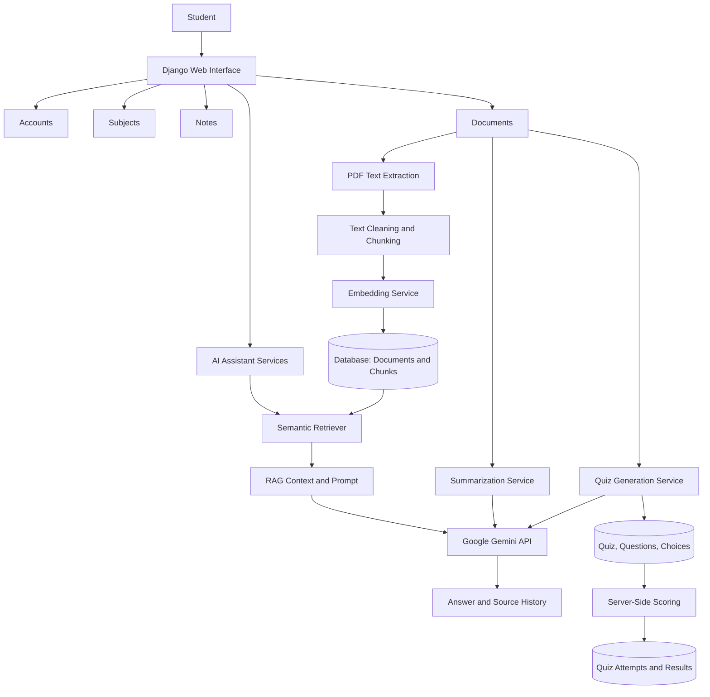
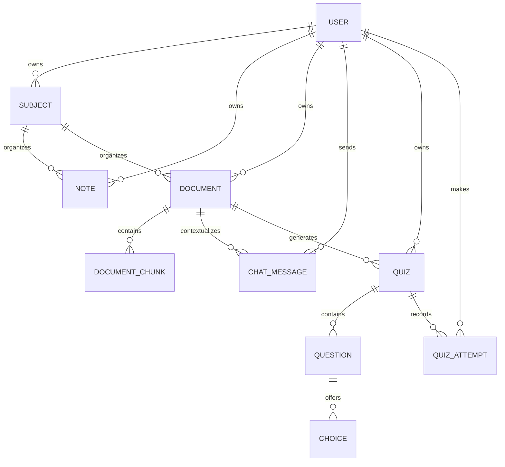
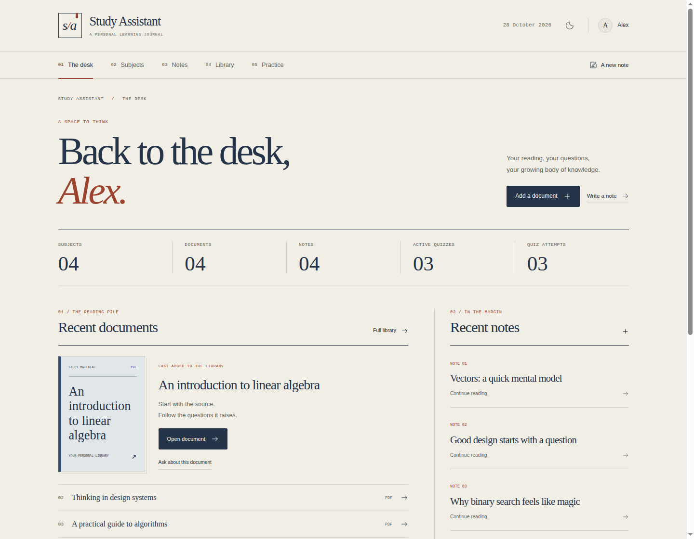

# AI Study Assistant

**An AI-powered learning platform that transforms study documents into summaries, document-grounded answers, and interactive quizzes.**

AI Study Assistant is a Django web application designed to help students organize their study materials and learn more efficiently. Users can manage subjects and notes, upload PDF documents, generate AI-powered summaries, ask questions about document content using Retrieval-Augmented Generation (RAG), and create quizzes from their learning materials.

> **Project status:** Local Django application with tested core workflows. Not deployed. See [the requirements audit](docs/REQUIREMENTS_AUDIT.md) and [implementation report](docs/IMPLEMENTATION_REPORT.md) for verified results and outstanding release checks.

---

## Table of Contents

- [Overview](#overview)
- [Key Features](#key-features)
- [Technology Stack](#technology-stack)
- [Architecture](#architecture)
- [How RAG Works](#how-rag-works)
- [Project Structure](#project-structure)
- [Data Model Overview](#data-model-overview)
- [Getting Started](#getting-started)
- [Environment Configuration](#environment-configuration)
- [Running the Application](#running-the-application)
- [Running Tests](#running-tests)
- [Security Notes](#security-notes)
- [Known Limitations](#known-limitations)
- [Potential Future Improvements](#potential-future-improvements)
- [Portfolio Highlights](#portfolio-highlights)

---

## Overview

Students often work with lengthy PDFs, lecture notes, and learning materials. Finding relevant information, reviewing long documents, and creating practice questions manually can be time-consuming.

AI Study Assistant combines study-material management with AI features in one application. It processes uploaded PDF documents, stores their text in manageable chunks, generates embeddings for semantic retrieval, and uses relevant passages as context for AI-generated answers.

The application also supports AI-generated summaries and multiple-choice quizzes to help students review their learning materials.

## Key Features

### Study Workspace
- A study-journal identity with a numbered desktop index, mobile drawer, paper/ink/rust palette, serif typography and document-led layouts.
- Light and dark themes, with the theme preference saved locally.
- Instant filters for subjects, documents and quizzes; existing server-side notes search.
- PDF drag and drop, file feedback, and honest processing/loading states.
- AI question suggestions, expandable sources, and copy controls.
- Quiz progress, question shortcuts, clear selected answers and answer review.
- Keyboard navigation, visible focus, reduced-motion support and mobile layouts.

See the [UI review](docs/UI_REVIEW.md) for screenshots and browser verification.

### User Authentication
- User registration, login, and logout.
- Authenticated access to protected pages.
- User-specific study resources and ownership checks.

### Subject Management
- Create, view, update, and delete subjects.
- Organize notes and documents by subject.

### Notes Management
- Create, view, update, and delete notes.
- Associate notes with subjects.
- Search notes by title, content, and subject.
- Paginated note listings.

### PDF Document Processing
- Upload PDF study documents.
- Validate the PDF signature and extension and enforce a 10 MB file-size limit.
- Reject malformed, encrypted and textless PDFs with form errors.
- Extract text from PDF pages using PyPDF.
- Clean extracted text.
- Split document text into overlapping chunks.
- Store document chunks and their embeddings.
- View and manage uploaded documents.

The current processing service uses **500-character chunks and 100-character overlap**, with recursive paragraph/line/sentence/word splitting. Embeddings are generated and validated before an atomic replacement of extracted text and chunks. Failed replacement preserves existing database content. Uploaded PDFs are streamed through an authenticated ownership-checked view; media storage must remain private.

### AI-Powered Summarization
- Generate summaries from extracted document text.
- Use Google Gemini for language generation.
- Save summaries with documents for later viewing.
- Read summaries and chat answers with formatted headings, lists, emphasis and code; HTML space entities are decoded. Existing saved content displays correctly without regeneration.
- Handle AI service errors through the application service layer.

### Document Question Answering with RAG
- Generate embeddings for document chunks and user questions.
- Retrieve relevant passages using cosine similarity.
- Rank retrieved passages and apply configurable thresholds.
- Generate answers using retrieved document context.
- Return a safe response when relevant evidence is insufficient.
- Store chat history and source references.
- Display source information alongside answers.

### AI Quiz Generation
- Generate multiple-choice quizzes from document content.
- Validate structured AI output before persistence.
- Store questions, choices, explanations, difficulty, and source chunk references.
- Take quizzes and calculate scores on the server.
- Save quiz attempts and results.
- Review submitted answers and correct answers.
- Maintain active and inactive quiz states.

---

## Technology Stack

| Technology | Purpose |
|---|---|
| Python 3.12.3 (verified locally) | Main programming language |
| Django 6.1.1 | Web framework, ORM, views, forms, and authentication |
| Django REST Framework 3.18.0 | Existing owner-scoped Quiz list, detail and attempt API |
| Google Gemini API | Summarization, RAG answer generation, and quiz generation |
| `google-genai` | Google GenAI Python SDK |
| Sentence Transformers | Text embeddings for semantic retrieval |
| `all-MiniLM-L6-v2` | Embedding model |
| PyPDF 6.16.2 / langchain-text-splitters 1.1.3 | PDF extraction / recursive character chunking |
| SQLite | Initial development database |
| HTML and CSS | Page structure and styling |
| Local CSS | Responsive styling for the existing Bootstrap-style template classes; no Bootstrap runtime dependency |
| JavaScript | Browser-side interactions |
| Django test framework | Automated tests |
| Git | Version control |

**Database note:** SQLite has been used during initial development. PostgreSQL should only be listed as an implemented database if it has been configured and tested in the current project.

---

## Architecture

The project is organized as a Django application with separate apps and service modules. The components are not necessarily separate network services.



### Service-layer organization

AI and quiz logic is separated into focused services where implemented, including:

- LLM integration
- Summarization
- Embedding generation
- Document retrieval
- RAG answer generation
- Quiz generation
- Quiz persistence
- Quiz scoring

The dashboard reports owner-scoped subject, note, document, active quiz and attempt counts, and up to five recent documents, notes, active quizzes and results. It uses a fixed number of database queries and supports empty libraries.

This separation helps keep request-handling code focused and allows service behavior to be tested independently.

## How RAG Works

Retrieval-Augmented Generation supplies relevant information from a document to a language model before asking it to answer a question.

### Document ingestion

```text
PDF upload
   ↓
Extract text with PyPDF
   ↓
Clean extracted text
   ↓
Split text into overlapping chunks
   ↓
Generate chunk embeddings
   ↓
Store chunks and embeddings
```

### Question answering

```text
Student question
   ↓
Validate and preprocess question
   ↓
Generate question embedding
   ↓
Compare it with stored chunk embeddings
   ↓
Rank and filter relevant chunks
   ↓
Check retrieval thresholds
   ↓
Build a prompt using retrieved context
   ↓
Generate an answer with Gemini
   ↓
Save answer and source references
```

### Embeddings and similarity

The project uses Sentence Transformers with `all-MiniLM-L6-v2` to represent text as numerical vectors. This model produces 384-dimensional embeddings. Cosine similarity is used to compare the question vector with document-chunk vectors.

Example configuration values used during development:

| Setting | Example default |
|---|---:|
| `RAG_TOP_K` | `5` |
| `RAG_SIMILARITY_THRESHOLD` | `0.25` |
| `RAG_MIN_CONFIDENCE` | `0.60` |

The current environment and Django settings are the source of truth for these values. Similarity scores are retrieval heuristics; they do not guarantee factual correctness. RAG can reduce unsupported answers but cannot eliminate hallucinations.

### Source references

The application stores information about retrieved chunks with chat messages, including chunk identifiers, chunk positions, similarity scores, and a snapshot of the source content. This supports displaying the document passages used to ground an answer.

---

## Project Structure

The current project has the following main directories. `api/` is a placeholder app; the existing API implementation lives in `quizzes/`.

```text
ai-study-assistant/
├── manage.py
├── config/
├── accounts/
├── subjects/
├── notes/
├── documents/
│   ├── models.py
│   ├── views.py
│   └── ...
├── ai_assistant/
│   ├── services/
│   │   ├── llm.py
│   │   ├── summarizer.py
│   │   ├── embeddings.py
│   │   ├── rag.py
│   │   └── ...
│   ├── prompts/
│   ├── models.py
│   └── ...
├── quizzes/
│   ├── models.py
│   ├── services/
│   │   ├── quiz_generator.py
│   │   ├── quiz_persister.py
│   │   └── quiz_scorer.py
│   ├── templates/
│   ├── tests.py
│   └── ...
├── dashboard/
├── api/
├── templates/
├── static/
├── media/
├── requirements.txt
├── .env.example
└── README.md
```

---

## Data Model Overview

The core relationships include:



This diagram is a simplified conceptual view. Refer to the actual Django models and migrations for the authoritative schema.

---

## Getting Started

### Prerequisites

- Python 3.12 or a compatible Python version supported by the installed dependencies.
- Git.
- A Google Gemini API key for AI features.
- Internet access for initial dependency installation and model downloads.

### 1. Clone the repository

Replace the placeholder with your repository URL:

```bash
git clone <YOUR_REPOSITORY_URL>
cd <YOUR_PROJECT_DIRECTORY>
```

### 2. Create and activate a virtual environment

On Linux or macOS:

```bash
python3 -m venv venv
source venv/bin/activate
```

### 3. Install dependencies

```bash
pip install -r requirements.txt
```

The manifest preserves the working environment's pinned versions, including large Torch/CUDA packages. Installation requires substantial disk space and a compatible platform. A clean dependency download/install has not been verified in the restricted audit environment; the installed environment passed `pip check`. No major dependency upgrades were made.

### 4. Configure environment variables

Copy the safe example and generate your own stable Django key:

```bash
cp .env.example .env
python -c "from django.core.management.utils import get_random_secret_key; print(get_random_secret_key())"
```

Set `DJANGO_SECRET_KEY` in `.env` to the generated value. Set `GEMINI_API_KEY` privately and choose a model available to your Gemini account. Do not commit `.env`. Without a Gemini key, ordinary CRUD works and AI actions show an error. The embedding model downloads on first processing/retrieval; its Python import and initialization are lazy.

### 5. Apply database migrations

```bash
python manage.py migrate
```

### 6. Create an administrator account

```bash
python manage.py createsuperuser
```

### 7. Start the development server

```bash
python manage.py runserver
```

Open the local development address shown by Django in your browser.

> These instructions run a local development server. A public deployment has not been configured or verified.

---

## Environment Configuration

Create a `.env` file in the location expected by the project's settings module.

Example:

```env
DJANGO_DEBUG=true
DJANGO_SECRET_KEY=generate_your_own_value
DJANGO_ALLOWED_HOSTS=localhost,127.0.0.1,[::1]
GEMINI_API_KEY=
GEMINI_MODEL=gemini-3.6-flash
EMBEDDING_MODEL=all-MiniLM-L6-v2
RAG_TOP_K=5
RAG_SIMILARITY_THRESHOLD=0.25
RAG_MIN_CONFIDENCE=0.60
```

These names and defaults match `config/settings.py`; environment values override defaults. The configured Gemini model has not been checked against a live account. The complete safe template is [.env.example](.env.example). The settings module loads the repository-root `.env` without overriding exported variables.

For deployment set `DJANGO_DEBUG=false`, a unique secret key and explicit hostnames. Missing a secret key in this mode prevents startup. Secure session/CSRF cookies and HTTPS redirects are enabled when debug is disabled. Development defaults to debug mode; without a key it uses an ephemeral key and sessions reset across restarts. Production hosting, HTTPS termination, static serving and backups require separate configuration. Never expose `MEDIA_ROOT` through a public web server or object-storage URL; use `/documents/<id>/file/`. Run `python manage.py check --deploy` with the intended production environment and review every warning. Console email is used in development; debug-disabled settings use SMTP configured through `DJANGO_EMAIL_HOST`, `DJANGO_EMAIL_PORT`, `DJANGO_EMAIL_USER`, `DJANGO_EMAIL_PASSWORD` and `DJANGO_EMAIL_USE_TLS`. No current user flow sends email, and SMTP delivery has not been verified. HSTS remains opt-in through `DJANGO_SECURE_HSTS_SECONDS`; do not enable it until HTTPS is configured correctly.

### Security reminders

- Never commit `.env` to version control.
- Never publish your Gemini API key in source code, screenshots, logs, or README examples.
- Commit `.env.example` with placeholders only.
- Rotate a key immediately if it is accidentally exposed.
- Keep development and production settings separate.

---

## Running the Application

Common local development commands:

```bash
# Start the Django development server
python manage.py runserver

# Check Django configuration
python manage.py check

# Show migration status
python manage.py showmigrations

# Create migrations after model changes
python manage.py makemigrations

# Apply migrations
python manage.py migrate
```

Review generated migrations before applying schema changes, particularly if the database already contains important data.

After adding a template-tag module, restart the development server once (Ctrl+C, then
`venv/bin/python manage.py runserver`). A browser refresh does not rebuild an already running
server's template-library registry. The AI formatter is explicitly registered in `TEMPLATES`
under `OPTIONS.libraries`; if an older process reports that `study_formatting` is not registered,
restart it to load the updated settings. See [Django's template-tag documentation](https://docs.djangoproject.com/en/4.1/howto/custom-template-tags/).

## Running Tests

Run the full test suite:

```bash
python manage.py test
```

Run Django's system checks:

```bash
python manage.py check
```

You can also run tests for an individual app, for example:

```bash
python manage.py test quizzes
```

The pre-change baseline passed **61 tests** using the cached embedding model with `HF_HUB_OFFLINE=1 TRANSFORMERS_OFFLINE=1`. After the AI readability fix, the full suite passed **151 tests in 63.680 seconds** on 2026-10-28. Ordinary tests mock external model/API work and do not require API keys or network downloads. See [the implementation report](docs/IMPLEMENTATION_REPORT.md) for commands and verification limits.

```bash
python manage.py makemigrations --check --dry-run
python manage.py migrate --check
python -m pip check
```

Tests use an isolated test database and temporary upload directories, preserving the working database and existing PDFs.

---


## Quiz workflow and existing API

The generator samples chunks across the document, labels them with their database IDs,
and sends a bounded context to Gemini. JSON validation checks question text, four distinct
choices, answer index 0–3, difficulty and document source IDs. Invalid output gets one retry.
The persistence transaction deactivates previous quizzes only when the replacement saves
successfully. Attempts store the server-computed score, total question count and per-question
review. Old attempts remain readable after regeneration.

The existing API uses DRF session authentication (CSRF applies) and Basic authentication
(use HTTPS). It contains only these endpoints:

| Method | Endpoint | Behavior |
| --- | --- | --- |
| GET | `/api/quizzes/` | Paginated active quizzes belonging to the user, 20 per page |
| GET | `/api/quizzes/<id>/` | Own active quiz and choices; no answer key or explanation |
| POST | `/api/quizzes/<id>/attempt/` | Score and persist an attempt |

Example submission body: `{"answers": {"123": 0, "124": 2}}`, where keys are question IDs
and choice indexes are 0–3. At least one answer is required by the existing API serializer.
Missing questions and out-of-range integer choices count as wrong. Unknown numeric IDs
and submitted score/correctness fields cannot change the server score. Malformed values
return 400, foreign/inactive quizzes return 404, and unauthenticated requests are rejected.
Explanations are shown after submission in the web result review.

## Security Notes

The implementation and regression tests cover the following practices:

- Require authentication for private study resources.
- Scope database queries to the current user.
- Validate uploaded files and enforce size limits.
- Preserve Django CSRF protection.
- Validate AI-generated data before saving it.
- Calculate quiz scores on the server.
- Keep API credentials in environment variables.
- Avoid exposing internal exception details to end users.
- Test that users cannot access other users' resources by changing URL identifiers.

This targeted review is not a comprehensive security assessment. Login throttling, quota controls, upload malware scanning and production monitoring are not implemented. Existing migrations and data were preserved. Already tracked bytecode is a repository hygiene issue; `.gitignore` prevents new cache files but does not untrack existing ones.

---

## Known Limitations

The following limitations should be reviewed against the current implementation before release:

- Image-only or scanned PDFs may require OCR, which is not assumed to be implemented.
- PDF text extraction quality depends on the source document.
- Retrieval thresholds may need evaluation on representative documents and questions.
- A high retrieval similarity score does not guarantee a correct answer.
- AI output can still be incomplete or incorrect and should be reviewed.
- Synchronous processing of large PDFs may take time.
- SQLite and synchronous processing are the current implementation; no queue, Redis or PostgreSQL service is configured. The 10 MB upload limit does not bound expanded PDF text size or processing time; use small trusted study PDFs for demonstrations.
- Replacement data generation happens outside database transactions, then database updates are atomic. File storage is not transactional: rare database failures after a new file write can leave an orphan file. Deleting a document/subject retains stored PDF bytes; storage cleanup requires a separately reviewed process.
- The deployment environment, HTTPS, static serving, private media, backups and monitoring must be verified separately.
- Dedicated analytics and cross-module search are not implemented. Notes search and dashboard counts/recent results are implemented.
- Quiz generation samples document chunks within a context budget; it does not guarantee coverage of every topic. New quiz source IDs are checked against supplied chunks; legacy questions can have empty references. A later successful document reprocess replaces chunk IDs, so old quiz source excerpts may no longer be available; chat sources retain content snapshots.

---

## Potential Future Improvements

Possible next steps include:

- Study analytics and quiz-performance visualizations.
- Global search across subjects, notes, documents, and quizzes.
- Background PDF and AI processing with Celery and Redis.
- PostgreSQL deployment and evaluation of vector-search options.
- Additional API endpoints and API documentation where required.
- OCR for scanned PDFs and measured resource limits for unusually large or adversarial PDFs.
- Production logging, monitoring, and error reporting.
- Docker-based development and deployment.
- More integration and security tests.
- UI accessibility and mobile usability improvements.
- A deployed demo with sample data and screenshots.

These are potential improvements, not claims that they are already implemented.

---

## Portfolio Highlights

This project demonstrates practical experience with:

- Django application architecture and ORM relationships.
- Authentication and user-specific access control.
- CRUD workflows, search, and pagination.
- PDF upload and text-processing pipelines.
- External LLM API integration.
- Prompt engineering and structured AI output validation.
- Text embeddings and semantic retrieval.
- Retrieval-Augmented Generation (RAG).
- Similarity filtering and source references.
- Server-side quiz scoring and persistent attempts.
- Automated testing and incremental development.

### Short project description

> Developed an AI-powered study platform using Django and Google Gemini. Implemented PDF processing, AI-generated summaries, semantic document retrieval with Sentence Transformers, RAG-based question answering with source references, and interactive quiz generation with server-side scoring.

---

## Screenshots and Demo

These are actual Chromium captures of the Django templates using **synthetic demo data**.
The preview uses an isolated in-memory database. Gemini is not called; the example summary
and conversation are demonstration fixtures, not evidence of live AI output.



| More views | Preview |
| --- | --- |
| Mobile overview | [Open screenshot](docs/screenshots/dashboard-mobile.png) |
| Dark theme | [Open screenshot](docs/screenshots/dashboard-dark.png) |
| Library index | [Open screenshot](docs/screenshots/documents-desktop.png) |
| Subject files | [Open screenshot](docs/screenshots/subjects-desktop.png) |
| Documents and summary | [Open screenshot](docs/screenshots/document-desktop.png) |
| AI conversation | [Open screenshot](docs/screenshots/qa-desktop.png) |
| Quiz practice | [Open screenshot](docs/screenshots/quiz-desktop.png) |
| Quiz review | [Open screenshot](docs/screenshots/result-desktop.png) |
| Sign in | [Open screenshot](docs/screenshots/login-desktop.png) |

The [UI review](docs/UI_REVIEW.md) includes the browser checks and reproduction commands.
A live Gemini demonstration is still a separate release check.

---

## License

Choose and add a license before distributing this project publicly. Do not add a license unless you intend to grant the permissions it specifies.

---

**Built as a practical project exploring full-stack web development and AI-assisted learning.**
